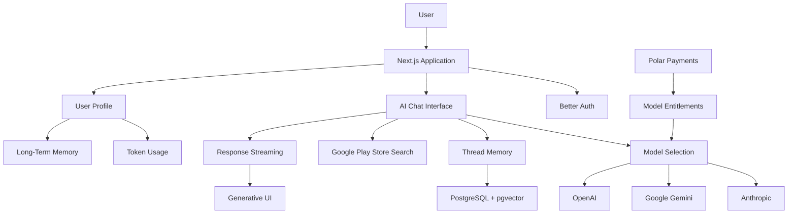

# ✨ Astra-GPT

### Your AI workspace with multiple models, intelligent memory, and generative UI.

Astra-GPT is a multi-model AI application that brings different AI providers into a single conversational experience. Users can interact with models from Anthropic, Google Gemini, and OpenAI, explore personalized AI conversations, and build a persistent memory that helps AI models understand relevant context from previous interactions.

With real-time response streaming, Google Play Store search, model-specific subscriptions, and long-term memory, Astra-GPT goes beyond a traditional AI chatbot.

---

## 🚀 Features

### 🤖 Multi-Model AI Chat

Interact with multiple AI providers from a single application.

- Support for models from Anthropic, Google Gemini, and OpenAI.
- Choose different models based on your needs.
- Access models through individual purchases and subscriptions.
- Maintain conversations across different models.

### 🔐 Authentication & Authorization

Secure authentication and access management powered by Better Auth.

- User sign-up and sign-in functionality.
- Secure user session management.
- Authentication-aware application access.
- Authorization for accessing purchased AI models and premium features.

### 🧠 Intelligent Thread Memory

Astra-GPT maintains conversation context through thread memory, allowing AI models to understand previous interactions and provide more relevant responses.

- Maintain context throughout a conversation.
- Retrieve relevant information from previous messages.
- Generate context-aware responses.
- Support persistent memory for longer conversations.

### 💬 Generative UI

Astra-GPT transforms AI responses into dynamic user interfaces rather than displaying everything as plain text.

- Render AI-generated interfaces directly in the conversation.
- Display structured responses and interactive content.
- Create a more engaging conversational experience.
- Stream generated content to the client as it becomes available.

### ⚡ Real-Time Streaming

AI responses are streamed directly to the client instead of waiting for the complete response payload.

- Incremental response delivery.
- Reduced perceived response latency.
- Improved conversational experience.
- Avoid buffering the entire response before displaying it.

### 🔎 Google Play Store Integration

Astra-GPT can search the Google Play Store to discover relevant applications and retrieve appropriate information based on user queries.

- Search for relevant applications.
- Retrieve useful application information.
- Integrate search results into AI conversations.
- Stream the resulting content directly to the client.

### 💳 Model Access & Payments

Payment integration powered by Polar allows users to purchase access to specific AI models.

- Purchase individual AI model access.
- Control model availability based on user entitlements.
- Integrate payments into the AI application.
- Provide a premium experience for paid models.

### 👤 Detailed User Profile

A personalized profile page gives users visibility into their AI usage and account information.

- View account information.
- Track token consumption.
- Monitor tokens exhausted across AI interactions.
- Manage purchased model access.
- Access account-related information in one place.

### 🗂️ Long-Term Memory

Users can purchase long-term memory to help Astra-GPT retain relevant information beyond individual conversations.

Long-term memory enables the application and its AI models to make better use of past interactions.

- Retain relevant information from previous conversations.
- Retrieve useful context when starting new conversations.
- Improve personalization across AI interactions.
- Help models remember relevant user preferences and historical context.

---

## 🛠️ Tech Stack

| Technology | Purpose |
|---|---|
| Next.js | Application framework |
| Better Auth | Authentication and authorization |
| Drizzle ORM | Type-safe database interactions |
| PostgreSQL | Relational database |
| pgvector | Vector storage and similarity search |
| Anthropic | AI model integration |
| Google Gemini | AI model integration |
| OpenAI | AI model integration |
| Polar | Payment integration |
| Google Play Store | Application discovery and search |
| Streaming APIs | Incremental response delivery |

---

## 🏗️ Architecture Overview

Astra-GPT combines authentication, model access, persistent memory, and streaming into a single conversational workflow.

---

## 🧠 Memory System

Astra-GPT uses two types of memory to provide a more personalized AI experience.

| Memory | Description |
|---|---|
| Thread Memory | Maintains context within a conversation thread. |
| Long-Term Memory | Stores relevant information across conversations for future retrieval. |

The combination of thread memory and long-term memory helps AI models understand both the current conversation and relevant historical context.

PostgreSQL with pgvector provides the foundation for storing and retrieving relevant information using vector similarity search.

---

## 💳 Monetization

Astra-GPT integrates Polar to provide model-specific access through payments.

Users can purchase access to individual AI models, while the application manages access according to their purchased entitlements.

Long-term memory is also available as a paid feature, allowing users to extend the application's ability to retain relevant context across conversations.

---

## 🎯 Project Highlights

- Built a multi-provider AI chat application with a unified conversational interface.
- Integrated authentication and authorization using Better Auth.
- Implemented persistent thread memory and long-term memory capabilities.
- Used PostgreSQL and pgvector for relational and vector-based data storage.
- Built a generative UI experience for rendering structured AI responses.
- Integrated Google Play Store search into AI conversations.
- Implemented streaming responses to deliver content incrementally.
- Integrated Polar payments for model-specific access.
- Developed a user profile with token usage tracking and account management.

---

## 📌 Future Improvements

- Expand the supported AI model ecosystem.
- Improve memory retrieval and personalization.
- Add more interactive generative UI components.
- Improve token usage analytics.
- Enhance conversation management and search.
- Expand integrations with external services.

---

## 👨‍💻 Author

**Harsh Vardhan Bisht**

- GitHub: [@harry-sketch](https://github.com/harry-sketch)
- Project: [Astra-GPT](https://github.com/harry-sketch/Astra-GPT)

---

⭐ If you find Astra-GPT interesting, consider giving the repository a star!
